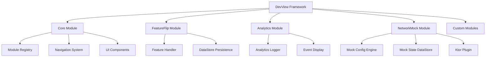

# DevView

<div align="center" markdown>


</div>

<div align="center" markdown>

**A powerful, modular developer tools framework for Kotlin Multiplatform applications**

<!-- renovate: datasource=maven depName=org.jetbrains.kotlin:kotlin-stdlib -->
[](https://kotlinlang.org)
<!-- renovate: datasource=maven depName=org.jetbrains.compose:compose-gradle-plugin -->
[](https://www.jetbrains.com/lp/compose-multiplatform/)
[](https://opensource.org/licenses/Apache-2.0)
[](https://github.com/worldline/devview)

</div>

---

## What's New

### v0.2.0

**Added
- Console: new `devview-consolelogger` module captures Android logcat and iOS stdout/stderr on-device, with optional `DevViewLogWriter` integration for [Kermit](https://github.com/touchlab/Kermit), configurable severity colors, search/level filters, selectable expandable messages, Copy log and follow/pause inspection. Untethered iOS `NSLog`/`os_log` requires writer integration. ([#109](https://github.com/worldline/devview/pull/109), [#163](https://github.com/worldline/devview/pull/163))
- NetworkMock: reload specs without restarting, lazily load response bodies, resolve chained/document-relative references with cycle and component-section validation, synthesize supported schema placeholders, and match required top-level request fields/discriminator values. Body matching only inspects already-buffered Ktor content; this is not full JSON Schema validation.
- NetworkMock: serve declared headers/media types, retain distinct media variants, support bodyless responses and OpenAPI 3.1 type arrays/null enum values, and resolve wildcard media types to concrete Content-Type. ([#138](https://github.com/worldline/devview/pull/138), [#141](https://github.com/worldline/devview/pull/141), [#144](https://github.com/worldline/devview/pull/144))
- NetworkMock: deterministic Timeout/Connection Refused, operation-level `x-devview.failureRate`, and persisted response sequences advancing per request and retaining the final step. Sequences support repeated steps, reorder/remove, editing/restart and at least two steps in the builder; `NetworkMockConfig.random` supports deterministic probability tests.
- Analytics: string event parameters and details with millisecond timestamps/timezone, selectable text and Copy event. ([#161](https://github.com/worldline/devview/pull/161))
- TimeCapsule: connected timeline, state-change summaries/highlighting, timestamps and owner subtitle; an additive `TimeCapsuleEffect` overload records detached `TextFieldState` text/selection and restores them alongside screen state. ([#111](https://github.com/worldline/devview/pull/111), [#146](https://github.com/worldline/devview/pull/146))
- DevView: public UI kit in `com.worldline.devview.ui`, `Section.displayName` and labelled custom-module toolbar menus. ([#159](https://github.com/worldline/devview/pull/159))

**Changed
- **Breaking — NetworkMock configuration:** migrate `mocks.json` to OpenAPI 3.x JSON or best-effort YAML, one spec per group. Use `NetworkMock(resourceLoader = loader, specPaths = listOf(...))`. Environments/overrides are removed; `servers` supplies matching hosts, declared examples replace response-suffix probing, and delays use `x-devview.delayMs`. Follow the [migration guide](https://worldline.github.io/devview/0.2.0/guides/migrating-to-openapi/) and `scripts/mocks_json_to_openapi.py`; review converter warnings on ambiguous overrides/identifiers. ([#104](https://github.com/worldline/devview/pull/104), [#108](https://github.com/worldline/devview/pull/108))
- **Breaking — NetworkMock runtime:** `ApiGroupConfig`/`Endpoint*` become `ApiSpec`/`Operation*`; keys drop environmentId, `Operation.method` is `HttpMethod`, and mock identity is `(statusCode, mediaType, exampleName)`, including `loadMockResponse(key, statusCode, mediaType, exampleName)`. Handle Failure/Sequence in exhaustive state branches. Legacy operation selections reset once at schema 2; the global toggle survives. ([#144](https://github.com/worldline/devview/pull/144))
- NetworkMock: saved per-group search and State/Version/Method/Tag filters plus sorting (including Mocked first), active counts, wrapping paths, quiet Network labels, theme-aware status colors and animated lists. `Operation.version` is display-only; sorting now lives in the filter panel. ([#119](https://github.com/worldline/devview/pull/119), [#165](https://github.com/worldline/devview/pull/165))
- NetworkMock: compact Responses/Failures operation sheets with direct network selection/search and inspect-without-selecting Details. Full-screen details provide Compare, Copy original body and Use/In use; full-screen sequence editing retains unresolved drafts. Reset all requires confirmation; configuration and recovery controls scroll at narrow sizes. ([#165](https://github.com/worldline/devview/pull/165), [#167](https://github.com/worldline/devview/pull/167))
- Console: read-only history with fresh recording identities; log through `ConsoleLogger.log()`. Persisted tag/message exclusions reject noise before buffering, merge device edits with host defaults and load before capture. Disabling rules admits future matches only, without deleting retained history; Clear filters disables rules and Reset restores current defaults. ([#163](https://github.com/worldline/devview/pull/163))
- FeatureFlip: labelled Remote/Off/On overrides and separate remote value; local flags retain switches. Saved search/Type/State filters show counts and recovery actions; override writes persist in click order. ([#160](https://github.com/worldline/devview/pull/160))
- DevView: destination-owned top bars transition with content, labelled accessible actions/tooltips and measured bottom insets. Animated home tiles use host-theme colors with explicit overrides supported; headings/subtitles, names/icons and dividers are clearer. ([#159](https://github.com/worldline/devview/pull/159))
- NetworkMock diagnostics use gated [Kermit](https://github.com/touchlab/Kermit), tag `DevViewNetworkMock`, without response bodies. Runtime dependencies include Ktor 3.6.0 and Kermit 2.2.0. ([#71](https://github.com/worldline/devview/pull/71), by [Renovate](https://github.com/apps/renovate))

**Removed
- **Breaking — built-in UI:** Analytics/FeatureFlip/NetworkMock/TimeCapsule screens and built-in NetworkMock view models are internal or removed; ConsoleScreen is also internal. Register modules with `rememberModules` and render `DevView`, not standalone built-in screens. `NetworkMockDestination.Endpoint` and endpoint UI types are removed; use core repositories for runtime configuration. `MockHttpClientCall` is internal.
- **Breaking — logger/custom-module API:** removed `LocalAnalytics`, prerelease `LocalConsoleLogs` and mutable history writes; submit through `AnalyticsLogger.log()`/`ConsoleLogger.log()`. Analytics copies parameters and assigns recording UUIDs without changing value equality. Toolbar action/menu require `label`, action callbacks receive displayed `NavKey`; fixed `Section.containerColor`/`contentColor` and `ModulePosition` are removed, with module defaults now `Color.Unspecified`.
- **Breaking — TimeCapsule:** `subtitle` is inserted between `label` and `maxEntries`; migrate positional calls to named `maxEntries`.

**Fixed
- NetworkMock: retained module sessions serialize writes and preserve selections/drafts across overlay hiding/host recreation. Failed writes offer Retry/Cancel and block conflicting actions. Revisions prevent stale sequence writes across repositories; concurrent consumption follows commit order, cancellation leaves uncommitted steps unconsumed and retries apply probability/delay at most once. Selected-mock/state-persistence failures do not fall back to real networking; superseded loads retry fresh state. Unmatched requests, Network selections and unavailable configurations still pass through. ([#167](https://github.com/worldline/devview/pull/167))
- NetworkMock: pretty-print valid JSON for preview/diff without changing served/copied bodies; malformed/non-JSON bodies stay unchanged. Lazy unwrapped panes scroll as a whole; wide Unicode lines remain reachable, diff caches survive recomposition and recovery remains reachable with long errors. ([#157](https://github.com/worldline/devview/pull/157), [#167](https://github.com/worldline/devview/pull/167))
- DevView: navigation uses the intended entry view model. Initialization effects remain after once-only DataStore setup, cancel on removal and restart on re-entry. Filtering out a displayed module returns Home/discards its entry draft, not its registered session; navigation checks pending writes at action time. ([#113](https://github.com/worldline/devview/pull/113))
- Analytics/Console: saved search, filters and inspection survive navigation; stable recording IDs prevent stale detail/anchor matches. Analytics counts use filtered results, empty searches remain recoverable and time windows refresh every five seconds. Console follows arrivals at capacity, restores paused row offsets after exclusions load, serializes clear/reconfiguration/capture lifetimes and cancels idle native readers cleanly. Both themes have improved severity/status label contrast. ([#161](https://github.com/worldline/devview/pull/161), [#163](https://github.com/worldline/devview/pull/163), [#167](https://github.com/worldline/devview/pull/167))
- FeatureFlip: independent per-feature retry preserves previous values after failure; newer choices supersede old failures and stale retries cannot overwrite them. Restored type filters remain active when registered types change. ([#167](https://github.com/worldline/devview/pull/167))
- TimeCapsule: only earlier entries offer Restore; expand controls have 48dp targets and saved expansion IDs prune on eviction/Clear. Selection-only restore avoids replacing text; bare-label quotes survive. ([#164](https://github.com/worldline/devview/pull/164), [#146](https://github.com/worldline/devview/pull/146), [#167](https://github.com/worldline/devview/pull/167))
- Sample: accessible labelled/inset-safe sections, theme-correct Android system bars, once-per-composition analytics seeding and cancellation-safe network results. ([#166](https://github.com/worldline/devview/pull/166))

---

## What is DevView?

DevView is an extensible, in-app developer tools framework designed for Kotlin Multiplatform applications. It provides a unified interface for debugging, testing, and managing development features across Android and iOS platforms.

---

## Getting Started

Ready to integrate DevView into your project?

<div class="grid cards" markdown>

- :material-download: **[Installation Guide](getting-started/installation.md)**

    Get DevView up and running in minutes

- :material-rocket-launch: **[Quick Start](getting-started/quick-start.md)**

    Build your first DevView integration

- :material-puzzle: **[Module Documentation](modules/index.md)**

    Explore available modules and features

- :material-code-braces: **[API Reference](api/index.html)**

    Detailed API documentation

</div>

---

## Key Features

- 🎯 **Modular Architecture** – Pick and choose the modules you need
- 🔧 **Feature Flag Management** – Toggle features on/off during development and testing
- 📊 **Analytics Debugging** – Monitor and inspect analytics events in real time
- 🎨 **Compose Multiplatform UI** – Native Material Design 3 interface
- 🔐 **Type-Safe Navigation** – Built on Navigation3 with kotlinx.serialization
- 💾 **Persistent State** – Feature states survive app restarts with DataStore
- 🚀 **Easy Integration** – Simple setup with minimal boilerplate
- 📱 **Cross-Platform** – Works seamlessly on Android and iOS

---

## Quick Example

```kotlin
@Composable
fun App() {
    var isDevViewOpen by remember { mutableStateOf(false) }
    val modules = rememberModules {
        module(FeatureFlip)
        module(Analytics())
    }
    Box {
        // Your main app content
        MainAppContent()
        // DevView overlay
        DevView(
            devViewIsOpen = isDevViewOpen,
            closeDevView = { isDevViewOpen = false },
            modules = modules
        )
        // Debug trigger
        FloatingActionButton(
            onClick = { isDevViewOpen = true }
        ) {
            Icon(Icons.Default.DeveloperMode, "Open DevView")
        }
    }
}
```

---

## Available Modules

### 🎚️ FeatureFlip

Manage feature flags with support for both local and remote features.

- Simple on/off toggles for local features
- Remote configuration with local overrides
- Persistent state management
- Search and filter capabilities

[Learn more about FeatureFlip →](modules/featureflip.md)

### 📊 Analytics

Monitor and debug analytics events in real time.

- Real-time event logging
- Multiple event types (Screen, Event, Custom)
- Tabular display with timestamps
- Event type filtering

[Learn more about Analytics →](modules/analytics.md)

### 🌐 NetworkMock

Mock and control network requests and responses for development and testing.

- Mock network requests and responses
- UI for toggling global and per-endpoint mocks
- Ktor plugin for HTTP interception
- Persistent configuration/state
- Multiplatform support (Android/iOS)

[Learn more about NetworkMock →](modules/networkmock.md)

### 🔧 Custom Modules

Extend DevView with your own custom modules.

- Simple module interface
- Type-safe navigation
- Automatic UI integration
- Section-based organisation

[Learn how to create custom modules →](modules/custom-modules.md)

---

## Why DevView?

> **Tip:** DevView is designed to save you time and make debugging, testing, and feature management a breeze. Integrate it early in your project for maximum benefit!

### For Developers

- **Faster Debugging** – Inspect feature flags and analytics without rebuilding
- **Better Testing** – Toggle features to test different configurations
- **Enhanced Visibility** – See exactly what's happening in your app
- **Time Savings** – No need to navigate deep into settings or rebuild

### For QA Teams

- **Feature Validation** – Verify features work in all states
- **Analytics Verification** – Confirm events fire correctly
- **Test Scenarios** – Easily switch between different feature configurations
- **Bug Reporting** – Include feature states in bug reports

### For Product Teams

- **Risk Mitigation** – Test features before full rollout
- **Gradual Rollouts** – Control feature availability
- **Quick Rollbacks** – Disable problematic features instantly
- **Data-Driven Decisions** – Monitor feature usage and analytics

---

## Platform Support

| Platform | Minimum Version | Status |
|----------|----------------|--------|
| Android  | API 26 (Oreo) | ✅ Stable |
| iOS      | iOS 16.0 | ✅ Stable |

---

## Architecture

DevView follows a modular architecture where each module is:

1. **Self-Contained** – Modules manage their own state and UI
2. **Type-Safe** – Uses kotlinx.serialization for navigation
3. **Composable** – Built entirely with Compose Multiplatform
4. **Extensible** – Easy to add new modules



---

## Community & Support

- 📖 **Documentation** – You're reading it!
- 💬 **Discussions** – [GitHub Discussions](https://github.com/worldline/devview/discussions)
- 🐛 **Bug Reports** – [GitHub Issues](https://github.com/worldline/devview/issues)
- 💡 **Feature Requests** – [GitHub Issues](https://github.com/worldline/devview/issues)

---

## Licence

DevView is released under the [Apache Licence 2.0](license.md).

```
Copyright 2024-2026 Maxime Michel

Licensed under the Apache Licence, Version 2.0 (the "Licence");
you may not use this file except in compliance with the Licence.
You may obtain a copy of the Licence at

    http://www.apache.org/licenses/LICENSE-2.0
```

---

<div align="center" markdown>

**Made with ❤️ by Maxime Michel**

[Get Started](getting-started/installation.md){ .md-button .md-button--primary }
[View on GitHub](https://github.com/worldline/devview){ .md-button }

</div>
