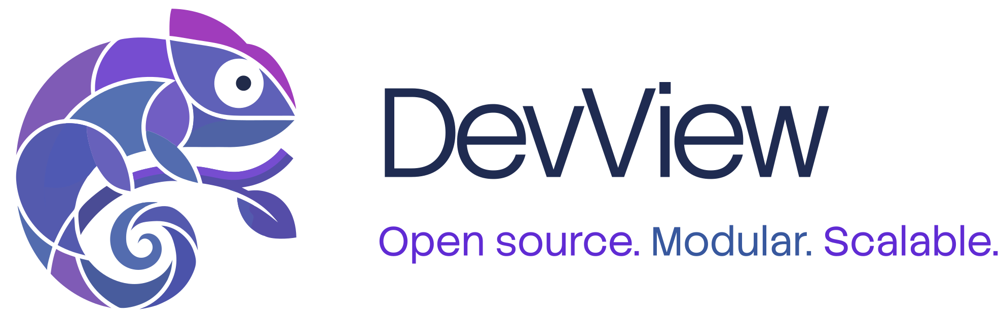
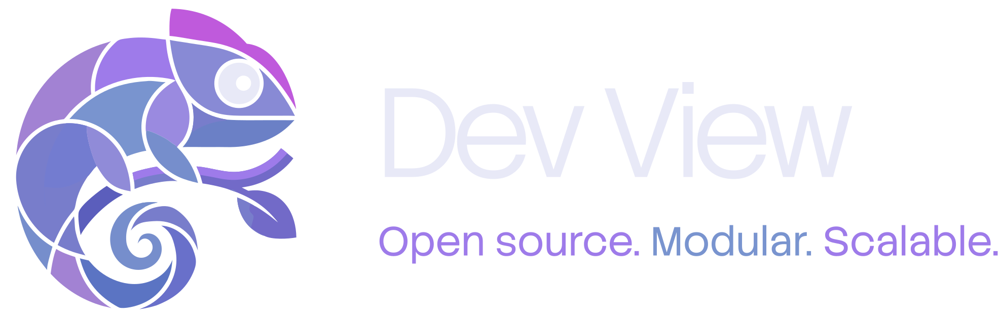
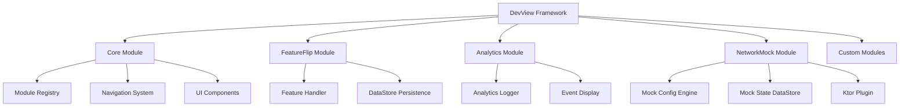

# DevView

<div align="center" markdown>




</div>

<div align="center" markdown>

**A powerful, modular developer tools framework for Kotlin Multiplatform applications**

<!-- renovate: datasource=maven depName=org.jetbrains.kotlin:kotlin-stdlib -->
[](https://kotlinlang.org)
<!-- renovate: datasource=maven depName=org.jetbrains.compose:compose-gradle-plugin -->
[](https://www.jetbrains.com/lp/compose-multiplatform/)
[](https://opensource.org/licenses/Apache-2.0)
[](https://github.com/worldline/devview)

</div>

---

## What's New

### v0.2.0-alpha08

**Added**

- Analytics: event details with string parameters, millisecond timestamps with timezone, selectable text and Copy event.
- DevView: public UI kit in `com.worldline.devview.ui` with section headings, grouped items, empty states, filter bars and a multiplatform copy callback; `Section.displayName` for headings.
- NetworkMock: "Mocked first" sort puts Mock, Failure, and Sequence operations before Network, preserving spec order within each group.

**Changed**

- Sample: labelled Compose, TimeCapsule and Network sections use one primary Open DevView action, spaced secondary controls, scrollable inset-safe content and a monospace result card. Counter controls have explicit accessible names, and section titles expose heading semantics.
- NetworkMock: the shared search/filter bar includes per-API-group Sort, State, Version, Method, and Tag selections with saved UI state and an active count. Clear filters keeps search; empty results offer Clear search and filters. Network is quiet text, and dark status chips use deep containers with light labels; both built-in palettes pass 4.5:1 label contrast tests.
- TimeCapsule: only earlier entries offer Restore, expand controls have standard 48dp targets, expansion survives screen recreation during the same recording, and empty history uses the shared guidance component. The existing timeline rail and change highlighting are preserved.
- Console: compact severity/time/tag rows expand to selectable multiline messages with horizontal scrolling and Copy log. Search and collapsible level filters retain UI state; the badge counts hidden levels and enabled noise rules. Newest-first rows follow the latest matching entry’s start at the top; paused arrivals keep the inspected row in place. History is a read-only snapshot. Enabled noise exclusions discard tag/message matches before buffering so excluded bursts cannot evict useful logs. Disabling a rule admits only future matches; previously retained history is not deleted. Host defaults merge with device-persisted additions, removals and enabled states; Clear filters disables rules and Reset restores current host defaults. Native capture waits for saved rules to load.
- DevView: module initialization effects remain in composition after once-only DataStore setup, survive recomposition, cancel on removal and restart on re-entry.
- Analytics: compact counts reflect filtered results, rows open event details, and the shared collapsible filter panel preserves search, selection and scroll state. Logger history is a read-only snapshot; record through `AnalyticsLogger.log()`, which assigns a fresh internal UUID and copies parameters without changing event value equality.
- FeatureFlip: remote overrides use labelled Material3 Remote/Off/On segments with the remote value shown separately. Local flags keep their switch; type badges are removed. Search and collapsible Type/State filters expose active counts and recovery actions and retain UI state. Selections persist in click order; failed saves keep the previous value and offer Retry. Restored type filters remain active when the registered feature types change.
- DevView: home icon tiles animate section hues with host-theme tones; explicit module overrides remain supported. Home uses sentence-case headings, readable subtitles, aligned dividers and a faint watermark in both themes. Built-in names are spaced and module icons are distinct.
- DevView: each destination now owns its top bar so titles and actions transition with content. Home has Close DevView and module screens have Back. Toolbar actions and menus require a user-facing `label` for accessibility and tooltips; action callbacks now receive the displayed `NavKey`. Module registration remains unchanged and receives its entry's measured bottom inset.
- NetworkMock: Reset all to network now asks for confirmation before clearing mocks, failures and sequences.
- NetworkMock: operation sheets pair a compact configuration summary with direct actual-network selection, Responses/Failures browsing tabs and response search. Status badges match the list; labelled Details buttons inspect without selecting. Sequence next-step, Edit and Restart controls share a compact header that wraps at narrow widths. Controls scroll when necessary to keep choices reachable. Full-screen response details provide Compare, selectable content, Copy body and Use/In use. The sequence builder uses stable step identities, Move up/down and Remove, preserves unresolved drafts and requires at least two steps. Saving or restarting position returns to the operation list.
- NetworkMock: one retained module session serializes accepted writes. Failed saves retain the selection/draft and offer Retry or Cancel while conflicting actions stay disabled. Overlay hiding and host configuration changes retain the session and entry drafts; filtering out a displayed module returns Home and discards its entry draft, not its registered session.
- NetworkMock core/Ktor: additive state revisions prevent stale sequence writes across repository instances. Concurrent requests consume steps in commit order and keep the final step selected; retries apply probability and configured delay at most once per request. An unavailable selected mock or state-persistence failure now fails without real-network fallback. Cancellation propagates without consuming an uncommitted sequence step.
- DevView: added a divider below the shared top app bar; NetworkMock operation lists animate filter and sort changes. Navigation guards consult pending mutations at action time.

**Removed**

- **Breaking** NetworkMock: `NetworkMockViewModel` is internal, matching the built-in screen boundary. Use module registration for UI and the core repositories for runtime configuration.
- **Breaking** DevView: built-in `AnalyticsScreen`, `ConsoleScreen`, `FeatureFlipScreen`, `NetworkMockScreen` and `TimeCapsuleScreen` are internal. Register modules through `rememberModules` and render `DevView`; module registration owns all tool content.
- Console: `LocalConsoleLogs` and direct writes to `ConsoleLogger.logs`; submit entries through `ConsoleLogger.log()` instead. Each recording gets a fresh internal UUID.
- Analytics: `LocalAnalytics` and direct writes to `AnalyticsLogger.logs`. The module reads its logger directly; register `Analytics()` to inspect its events in DevView.
- DevView: fixed `Section.containerColor` / `Section.contentColor` extensions and the public `ModulePosition` enum. Module colour defaults are now `Color.Unspecified`.

**Fixed**

- Docs: analytics integration no longer uses the removed `LocalAnalytics` provider, and module identity documentation covers built-in names, subtitles and icons.
- TimeCapsule: eviction and Clear prune saved expansion IDs during the same recording.
- Console: paused inspection restores its row and pixel offset after saved noise rules load; a missing anchor falls back to the newest matching row without resuming follow mode.
- FeatureFlip: failed saves retain independent per-feature retries. Newer choices supersede older failures for the same flag, and stale Retry callbacks cannot overwrite them.
- NetworkMock: superseded response-load failures retry the latest selection without real-network fallback.
- NetworkMock: long errors keep recovery actions visible, wide Unicode preview lines remain horizontally reachable, and response comparisons retain their diff cache across recompositions.
- Sample: Android status/navigation icon appearance follows the Dark Mode flag, including the navigation-bar background on API 26–28. Sample analytics seed once per composition instead of on every recomposition; cancelled requests are not displayed as errors.
- Console: severity label contrast in both palettes, recoverable empty results when all levels are hidden, and following new entries at full history capacity. Reconfiguration preserves pending entries within the new limit and trims history immediately; Clear removes pending entries and rejects stale deliveries. Capture and collection lifetimes are serialized during cancellation and re-entry. Cancellation terminates an idle Android logcat reader; iOS idle reads suspend and restore output descriptors on cancellation.
- CI: allow 60 minutes for the iOS job instead of 30.
- Analytics: category/time-only searches show recoverable no-results states, and limited time windows refresh every five seconds without user input. Restored details cannot resolve to a different recording with identical data. Newest-first rows do not automatically follow arrivals; the inspected row and offset survive returning from details while new events arrive.
- Sample: analytics seed events are recorded once per composition lifecycle instead of during recomposition, preventing duplicates and a feedback loop when observing the logger.
- NetworkMock: valid JSON is pretty-printed before preview display and diffing, and long lines stay unwrapped with whole-pane horizontal scrolling and lazy vertical rows instead of per-line scrolling or eagerly composing entire previews. Malformed JSON and non-JSON bodies stay unchanged; formatting does not alter served response bodies.

---

## What is DevView?

DevView is an extensible, in-app developer tools framework designed for Kotlin Multiplatform applications. It provides a unified interface for debugging, testing, and managing development features across Android and iOS platforms.

---

## Getting Started

Ready to integrate DevView into your project?

<div class="grid cards" markdown>

- :material-download: **[Installation Guide](getting-started/installation.md)**

    Get DevView up and running in minutes

- :material-rocket-launch: **[Quick Start](getting-started/quick-start.md)**

    Build your first DevView integration

- :material-puzzle: **[Module Documentation](modules/index.md)**

    Explore available modules and features

- :material-code-braces: **[API Reference](api/index.html)**

    Detailed API documentation

</div>

---

## Key Features

- 🎯 **Modular Architecture** – Pick and choose the modules you need
- 🔧 **Feature Flag Management** – Toggle features on/off during development and testing
- 📊 **Analytics Debugging** – Monitor and inspect analytics events in real time
- 🎨 **Compose Multiplatform UI** – Native Material Design 3 interface
- 🔐 **Type-Safe Navigation** – Built on Navigation3 with kotlinx.serialization
- 💾 **Persistent State** – Feature states survive app restarts with DataStore
- 🚀 **Easy Integration** – Simple setup with minimal boilerplate
- 📱 **Cross-Platform** – Works seamlessly on Android and iOS

---

## Quick Example

```kotlin
@Composable
fun App() {
    var isDevViewOpen by remember { mutableStateOf(false) }
    val modules = rememberModules {
        module(FeatureFlip)
        module(Analytics())
    }
    Box {
        // Your main app content
        MainAppContent()
        // DevView overlay
        DevView(
            devViewIsOpen = isDevViewOpen,
            closeDevView = { isDevViewOpen = false },
            modules = modules
        )
        // Debug trigger
        FloatingActionButton(
            onClick = { isDevViewOpen = true }
        ) {
            Icon(Icons.Default.DeveloperMode, "Open DevView")
        }
    }
}
```

---

## Available Modules

### 🎚️ FeatureFlip

Manage feature flags with support for both local and remote features.

- Simple on/off toggles for local features
- Remote configuration with local overrides
- Persistent state management
- Search and filter capabilities

[Learn more about FeatureFlip →](modules/featureflip.md)

### 📊 Analytics

Monitor and debug analytics events in real time.

- Real-time event logging
- Multiple event types (Screen, Event, Custom)
- Tabular display with timestamps
- Event type filtering

[Learn more about Analytics →](modules/analytics.md)

### 🌐 NetworkMock

Mock and control network requests and responses for development and testing.

- Mock network requests and responses
- UI for toggling global and per-endpoint mocks
- Ktor plugin for HTTP interception
- Persistent configuration/state
- Multiplatform support (Android/iOS)

[Learn more about NetworkMock →](modules/networkmock.md)

### 🔧 Custom Modules

Extend DevView with your own custom modules.

- Simple module interface
- Type-safe navigation
- Automatic UI integration
- Section-based organisation

[Learn how to create custom modules →](modules/custom-modules.md)

---

## Why DevView?

> **Tip:** DevView is designed to save you time and make debugging, testing, and feature management a breeze. Integrate it early in your project for maximum benefit!

### For Developers

- **Faster Debugging** – Inspect feature flags and analytics without rebuilding
- **Better Testing** – Toggle features to test different configurations
- **Enhanced Visibility** – See exactly what's happening in your app
- **Time Savings** – No need to navigate deep into settings or rebuild

### For QA Teams

- **Feature Validation** – Verify features work in all states
- **Analytics Verification** – Confirm events fire correctly
- **Test Scenarios** – Easily switch between different feature configurations
- **Bug Reporting** – Include feature states in bug reports

### For Product Teams

- **Risk Mitigation** – Test features before full rollout
- **Gradual Rollouts** – Control feature availability
- **Quick Rollbacks** – Disable problematic features instantly
- **Data-Driven Decisions** – Monitor feature usage and analytics

---

## Platform Support

| Platform | Minimum Version | Status |
|----------|----------------|--------|
| Android  | API 26 (Oreo) | ✅ Stable |
| iOS      | iOS 16.0 | ✅ Stable |

---

## Architecture

DevView follows a modular architecture where each module is:

1. **Self-Contained** – Modules manage their own state and UI
2. **Type-Safe** – Uses kotlinx.serialization for navigation
3. **Composable** – Built entirely with Compose Multiplatform
4. **Extensible** – Easy to add new modules



---

## Community & Support

- 📖 **Documentation** – You're reading it!
- 💬 **Discussions** – [GitHub Discussions](https://github.com/worldline/devview/discussions)
- 🐛 **Bug Reports** – [GitHub Issues](https://github.com/worldline/devview/issues)
- 💡 **Feature Requests** – [GitHub Issues](https://github.com/worldline/devview/issues)

---

## Licence

DevView is released under the [Apache Licence 2.0](license.md).

```
Copyright 2024-2026 Maxime Michel

Licensed under the Apache Licence, Version 2.0 (the "Licence");
you may not use this file except in compliance with the Licence.
You may obtain a copy of the Licence at

    http://www.apache.org/licenses/LICENSE-2.0
```

---

<div align="center" markdown>

**Made with ❤️ by Maxime Michel**

[Get Started](getting-started/installation.md){ .md-button .md-button--primary }
[View on GitHub](https://github.com/worldline/devview){ .md-button }

</div>
