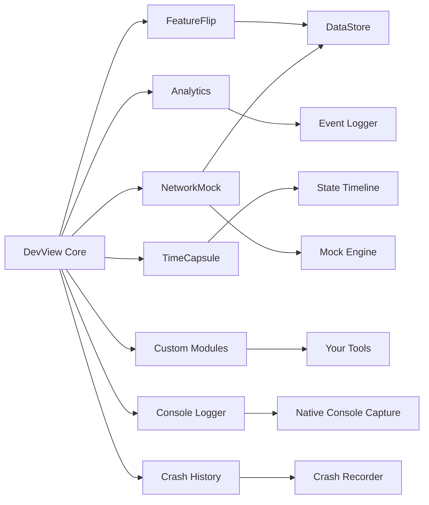

# Modules

DevView uses a modular architecture where each module provides specific developer tools functionality. Modules are plug-and-play and integrate seamlessly with the DevView core. You can include only the modules you need, and modules can be conditionally enabled based on build type, feature flags, or other criteria.

## Available Modules

| Module         | Purpose/Features                                                                 | Link                       |
|---------------|-----------------------------------------------------------------------------------|----------------------------|
| Core           | Foundation, navigation, module system                                            | Always required            |
| FeatureFlip    | Feature flag management (local/remote), persistent state, search/filter UI       | [Learn more ->](featureflip.md) |
| Analytics      | Real-time analytics event monitoring, event logging, tabular display, filtering  | [Learn more ->](analytics.md)   |
| Console Logger | Native console output (logcat/stdout) in-app, untethered, with level filters and text search | [Learn more ->](consolelogger.md) |
| Crash History  | Local, bounded history of crashes with stack traces, copy/share/export, no upload | [Learn more ->](crashhistory.md) |
| TimeCapsule    | Per-screen state history with restore, resets on navigation                       | [Learn more ->](timecapsule.md) |
| NetworkMock    | Mock network requests/responses, UI for toggling mocks, Ktor plugin integration  | [Learn more ->](networkmock.md) |
| Custom Modules | Extend DevView with your own developer tools                                     | [Creating Custom Modules ->](custom-modules.md) |

## When to Use Each Module
- **Core:** Required for all DevView functionality.
- **FeatureFlip:** Use for dynamic feature toggling.
- **Analytics:** Use for monitoring and debugging analytics events.
- **Console Logger:** Use to view native console output (logcat/stdout) in-app on a device with no debugger attached.
- **Crash History:** Use to read and share the stack trace of a crash on a device with no debugger or crash dashboard at hand.
- **TimeCapsule:** Use to capture and replay recent app states during debugging.
- **NetworkMock:** Use for simulating network responses, testing error handling, or developing offline features.
- **Custom Modules:** Use for bespoke developer tools tailored to your workflow.

## Module Architecture


DevView modules are plug-and-play, integrating seamlessly with the core. Modules can be conditionally enabled based on build type, feature flags, or other criteria.

## Integration Example
```kotlin
val modules = rememberModules {
    module(FeatureFlip)
    module(Analytics())
    module(Console())
    module(CrashHistory())
    module(TimeCapsule)
    module(NetworkMock(resourceLoader = NetworkMockResourceLoader { path -> Res.readBytes(path) }))
    module(MyCustomModule)
}
```

_If you are new to DevView, start with the Core module and add others as your project requirements evolve. For advanced usage, see the guides and examples sections._

